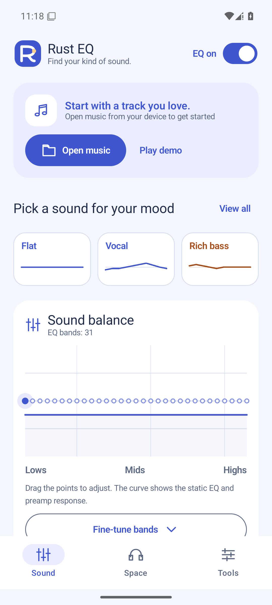

# Rust EQ

**Shape your sound.**

Rust EQ is an Android music player and equalizer that lets you tailor locally stored music to your taste. Its 10- or 31-band parametric EQ and frequency response graph give you control over bass, vocal presence, and treble balance.

Adjust dynamics with a compressor, change the stereo width, explore headphone spatial processing, or add reverberation with an impulse response. Save your settings as presets and switch between them to suit your music.

The Sound, Space, and Tools screens support Japanese and English. You can also view track information from selected external players and connect device EQ to compatible audio sessions.

## Download

[Rust EQ introduction and download](https://originapl.matchinfo-rank.com/ja/rusteq/)

Visit the page above for current release information and download options. Rust EQ supports Android 10 or later on arm64-v8a and x86_64. Save the APK and follow your device’s installation prompts.

## Key features

- **16 factory presets and virtual bass:** Start with presets such as Flat, Vocal, or Night, then adjust the amount and extraction frequency of harmonic bass enhancement.
- **10- or 31-band parametric EQ:** Adjust frequency, gain, and Q, or drag nodes directly on the response graph.
- **Correction from measurements:** Generate a 5- or 10-band PEQ and preamp setting from a CSV containing measurements and a target curve.
- **Dynamics and stereo controls:** Use a compressor, output peak limiting, Stereo Wide, and Crossfeed.
- **Headphone and room processing:** Import SOFA HRTF data, select Small Room, or load an impulse response up to eight seconds long.
- **Local music playback:** Play MP3, WAV, FLAC, Ogg Vorbis, AAC/M4A, and more, with seeking, a playback queue, automatic track advance, background playback, and notification controls.
- **Save and exchange settings:** Preserve EQ, preset names, the selected band, and spatial settings. Import or export JSON and import generated AutoEQ PK filter settings.
- **EQ for selected external players:** Search for apps, save multiple targets, tap Connect or Reconnect, and restore the listener after device restart. Optional enhanced detection with additional setup can find players that do not announce their audio sessions.
- **External playback information:** Show the selected app’s title, artist, playback state, and position in Sound and Playback details. Track changes and pauses update automatically; EQ connection status is shown separately.
- **Japanese and English:** Follow your device’s preferred language, or use Android’s per-app language setting on Android 13 or later.

## Getting started

On Android 10 or later, open a local music file or try the built-in demo. Adjust the EQ, save a preset, and use bypass to compare it with the original sound.

Music and measurement CSV files are processed on your device. The app requests neither internet access nor recording permission.

## View tracks from YouTube Music and other players

1. Select and save YouTube Music or another player in Tools → EQ for other apps. YouTube Music and YouTube are separate apps.
2. Open Playback details → Set up playback information access and allow notification access in Android settings. This is separate from ordinary notification permission and the optional DUMP permission used for enhanced EQ detection.
3. Play a track in the selected app, then return to Rust EQ. Tap Refresh playback information if needed.

If Android 13 or later blocks the setting, check App info → menu → Allow restricted settings. Rust EQ displays media information published by selected apps, without analyzing notification bodies or saving listening history. It clears track information when you deselect the app, the session ends, or notification access is revoked.

## Current scope

Version 0.4.5 is a development and evaluation build. The Rust DSP engine processes music played inside the app. External-player EQ works only with compatible audio sessions; it does not provide guaranteed system-wide processing for every app, including Spotify, YouTube, or YouTube Music.

Track information does not prove that EQ is connected. Phone EQ does not apply to audio playing on a cast device, and external audio is not included in Rust DSP measurements. Settings recovery after process termination has been tested, but force stops and device power-saving restrictions can prevent the listener from restarting automatically.

Validation on an Android 13 emulator passed 42 tests, including integration with a separate-UID player, plus 15 unit tests and 35 Rust tests. We also verified a same-key upgrade from 0.4.4, saved settings, and live metadata recovery after process termination. The current YouTube Music client and arm64 hardware have not been verified. See the [0.4.5 validation record](releases/0.4.5.json) for details.

HRTF processing requires separately supplied SOFA data that you have permission to use. No measured HRTF dataset is bundled. IR tails may be shortened according to quality settings, sample limits, and measured processing load. The AutoEQ optimizer is an independent implementation. Audio quality, thermal behavior, and extended playback still require testing on physical devices.

## Screenshots and documentation

- [Screenshot gallery](screenshots/README.md)
- [Measurement CSV and automatic correction](autoeq.md)
- [External-player EQ and its limitations](external-eq.md)
- [Language settings](localization.md)
- [Build and installation instructions](../README.md)
- [0.4.5 changes and validation](releases/0.4.5.md)
- [日本語の紹介文](introduction-ja.md)

The screenshot above shows the English UI. Most linked technical guides are in Japanese.

