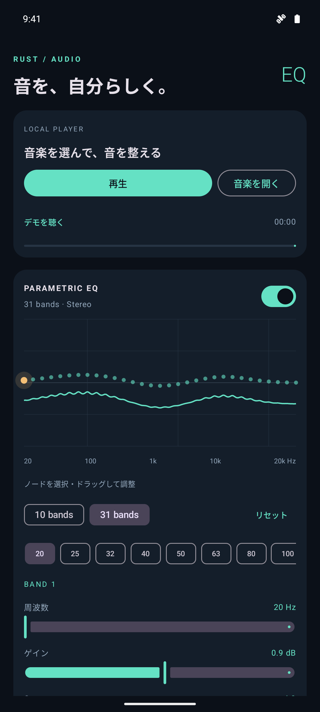

# Rust EQ

**Shape your sound.**

Rust EQ is an Android music player and equalizer that lets you tailor locally stored music to your taste. Its 10- or 31-band parametric EQ and frequency response graph give you control over bass, vocal presence, and treble balance.

Adjust dynamics with a compressor, change the stereo width, explore headphone spatial processing, or add reverberation with an impulse response. Save your settings as presets and switch between them to suit your music.

## Key features

- **10- or 31-band parametric EQ:** Adjust frequency, gain, and Q, or drag nodes directly on the response graph.
- **Correction from measurements:** Generate a 5- or 10-band PEQ and preamp setting from a CSV containing measurements and a target curve.
- **Dynamics and stereo controls:** Use a compressor, output peak limiting, Stereo Wide, and Crossfeed.
- **Headphone and room processing:** Import SOFA HRTF data, select Small Room, or load an impulse response up to eight seconds long.
- **Local music playback:** Play MP3, WAV, FLAC, Ogg Vorbis, AAC/M4A, and more, with seeking, a playback queue, automatic track advance, background playback, and notification controls.
- **Save and exchange settings:** Store presets, import or export JSON, and import generated AutoEQ PK filter settings.
- **Integration with cooperating players:** Apply the device's equalizer to audio sessions exposed by compatible external players.

## Getting started

On Android 10 or later, open a local music file or try the built-in demo. Adjust the EQ, save a preset, and use bypass to compare it with the original sound.

Music and measurement CSV files are processed on your device. The app requests neither internet access nor recording permission.

## Current scope

Version 0.4.0 is a development and evaluation build. The Rust DSP engine processes music played inside the app. External-player EQ works only with compatible audio sessions; it does not provide guaranteed system-wide processing for every app, including Spotify or YouTube.

HRTF processing requires separately supplied SOFA data that you have permission to use. No measured HRTF dataset is bundled. IR tails may be shortened according to quality settings, sample limits, and measured processing load. The AutoEQ optimizer is an independent implementation. Audio quality, thermal behavior, and extended playback still require testing on physical devices.

## Screenshots and documentation

- [Screenshot gallery](screenshots/README.md)
- [Measurement CSV and automatic correction](autoeq.md)
- [External-player EQ and its limitations](external-eq.md)
- [Build and installation instructions](../README.md)
- [Validation results](validation.md)
- [日本語の紹介文](introduction-ja.md)

The app screenshots and linked technical guides currently use Japanese.

## Presets and virtual bass

Choose from 16 factory presets, including Flat, Warm, Bass Boost, Deep Bass, Virtual Woofer, Vocal, Treble, Rock, Pop, Jazz, Classical, Acoustic, Electronic, Podcast, Night and Gaming. Virtual bass adds band-limited harmonics from low-frequency content; adjust its amount and extraction frequency. It operates on in-app playback and does not reproduce a physical subwoofer. Settings are stored in JSON v2, with support for importing v1 presets. [Preset and bass details (Japanese)](presets-bass.md).
