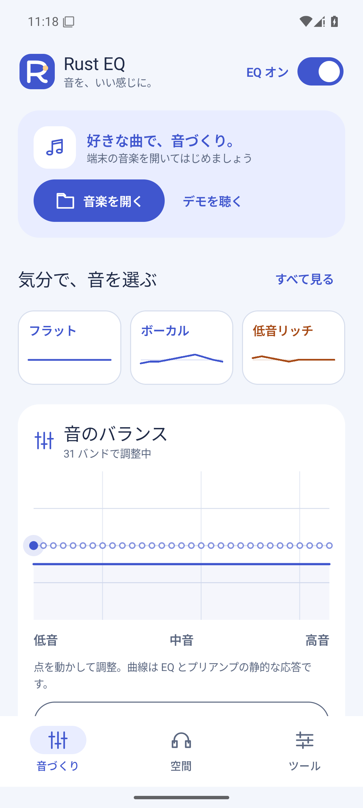

# Rust EQ

**音を、自分らしく。**

Rust EQ は、端末内の音楽を好みの音に調整できる Android 向け音楽プレーヤー／イコライザーです。10／31 バンドのパラメトリック EQ と周波数応答グラフで、低音の厚み、声の聴こえ方、高音のバランスを細かく調整できます。

コンプレッサーで音量差を整え、Stereo Wide や Crossfeed で左右の聴こえ方を調整。SOFA 形式の HRTF データや IR を読み込んで、ヘッドホンの空間表現やリバーブも楽しめます。設定をプリセットに保存すれば、音楽や気分に合わせて切り替えられます。

「音づくり」「空間」「ツール」の3画面で操作でき、日本語・Englishに対応します。選択した他アプリの曲名や再生状態を確認し、対応する音声セッションには端末EQを接続できます。

## ダウンロード

[Rust EQ の紹介・ダウンロード](https://originapl.matchinfo-rank.com/ja/rusteq/)

最新版の情報と配布先は上記ページで確認してください。Android 10以上、arm64-v8a／x86_64に対応します。APKを保存し、端末の案内に従ってインストールしてください。

## 主な機能

- **16種類の標準プリセットと疑似BASS**：音楽ジャンルや声に合わせて選択。倍音による低音の存在感も調整できます。
- **10／31 バンド PEQ**：周波数・ゲイン・Q を調整。グラフのノードをドラッグして編集できます。
- **測定値から自動補正**：測定・目標カーブの CSV から、5／10 バンド PEQ とプリアンプを生成します。
- **音量とステレオの調整**：コンプレッサー、出力ピーク制限、Stereo Wide、Crossfeed を搭載。
- **空間表現とリバーブ**：SOFA HRTF、Small Room、最大 8 秒の IR 読み込みに対応します。
- **ローカル音楽再生**：MP3、WAV、FLAC、Ogg Vorbis、AAC／M4A などを再生。シーク、再生キュー、自動次曲、バックグラウンド再生、通知操作を利用できます。
- **設定の保存と共有**：EQ・プリセット名・選択バンド・空間設定を保存。JSON 入出力と生成済み AutoEQ PK 設定の読み込みにも対応します。
- **対象を選んで使う他アプリEQ**：アプリを検索・複数選択して保存。未接続時の「接続」、再接続、再起動後の待ち受け復元に対応します。音声セッションを通知しないプレーヤーには、任意の拡張検出と追加設定を試せます。
- **他アプリの再生情報**：選択アプリの曲名・アーティスト・再生状態・再生位置を「音づくり」と「再生情報」に表示。曲変更や一時停止に追従し、EQ接続の状態も別に確認できます。
- **日本語・English**：端末の優先言語に合わせて表示。Android 13以降ではOSのアプリ言語設定でも選べます。

## はじめ方

Android 10 以上の端末で、「音楽を開く」からファイルを選ぶか、「デモを聴く」で操作を試してください。設定を変えたらバイパスで元の音と比較し、気に入った調整を保存できます。

音楽と測定 CSV は端末内で処理します。アプリはインターネット権限や録音権限を要求しません。

## YouTube Musicなどの曲情報を見る

1. 「ツール → 他アプリにもEQ」でYouTube Musicなどの対象を選び、保存します。YouTube MusicとYouTubeは別のアプリです。
2. 「再生情報 → 再生情報の表示を設定」からAndroidの「通知へのアクセス」を許可します。通常の通知表示許可や、EQの拡張検出に使うDUMP権限とは別の設定です。
3. 対象アプリで曲を再生してRust EQへ戻ります。必要なら「再生情報を再読み込み」を押してください。

Android 13以降で設定が制限される場合は「アプリ情報 → メニュー → 制限付き設定を許可」を確認してください。曲情報は選択したアプリが公開する情報を表示し、通知本文の解析や曲履歴の保存は行いません。選択解除・セッション終了・通知アクセスの取り消しで曲情報を消去します。

## 現在の対応範囲

バージョン 0.4.5 は開発・評価用です。Rust DSP の対象はアプリ内で再生する音楽です。他アプリ EQ は対応する音声セッションに限定され、Spotify、YouTube、YouTube Musicを含む全アプリへの適用を保証するものではありません。

曲情報を取得できても、EQが接続されたことを意味しません。キャスト先の音声には端末EQは適用されず、他アプリの音声はRust DSPの測定値には含まれません。プロセス終了後の設定復元は検証していますが、強制停止や端末の省電力設定で待ち受けの復元が制限される場合があります。

Android 13のエミュレーターで、別UIDプレーヤーとの連携を含む42件のテスト、単体15件、Rust35件が成功しました。同一署名の0.4.4からの更新、設定の保持、プロセス終了後の曲情報再取得も確認しています。現行YouTube Musicクライアントやarm64実機での動作は未確認です。詳細は[0.4.5の検証記録](releases/0.4.5.json)を参照してください。

HRTF は利用する権利のある SOFA データを別途用意してください。測定データは同梱していません。IR は品質設定・サンプル数上限・実測負荷に応じて短縮・調整します。AutoEQ 最適化器は独立した実装です。実機での音質・発熱・長時間再生の評価は継続課題です。

## 画面と使い方

- [標準プリセットと疑似BASS](presets-bass.md)
- [紹介用スクリーンショット](screenshots/README.md)
- [測定 CSV からの自動補正](autoeq.md)
- [他アプリ EQ の対応範囲](external-eq.md)
- [表示言語の設定](localization.md)
- [ビルド・導入手順](../README.md)
- [0.4.5の変更点と検証結果](releases/0.4.5.md)
- [English introduction](introduction-en.md)
