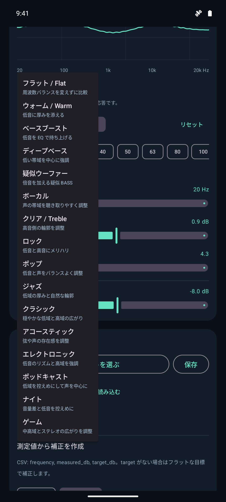
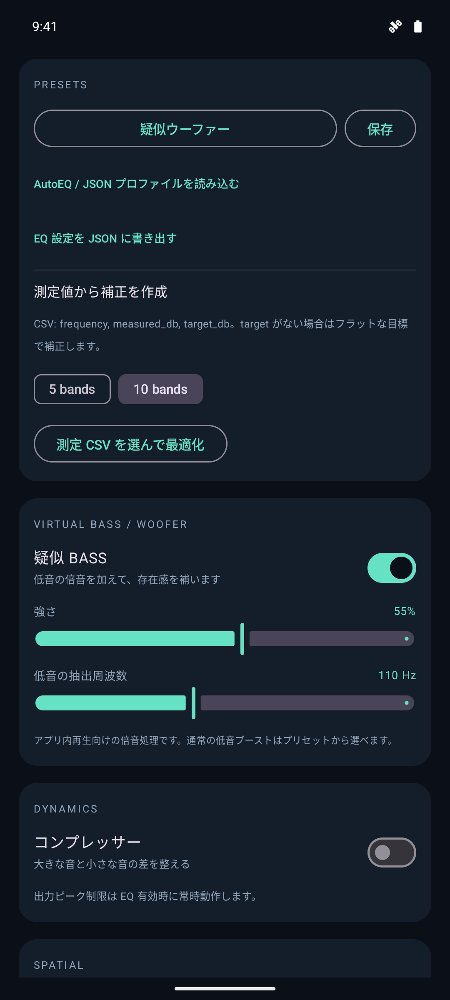
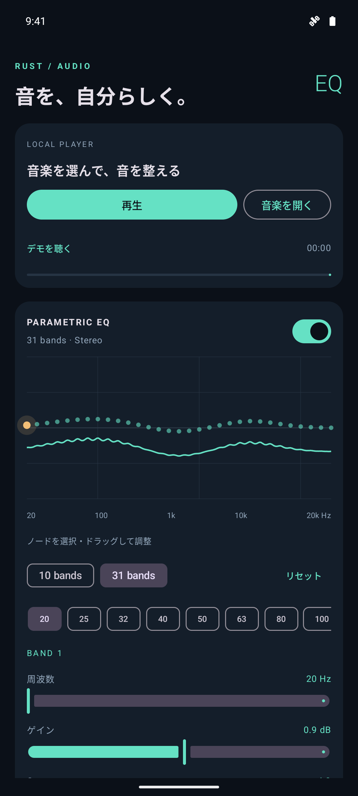
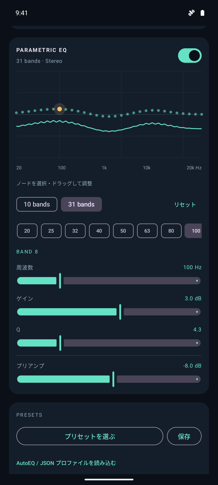
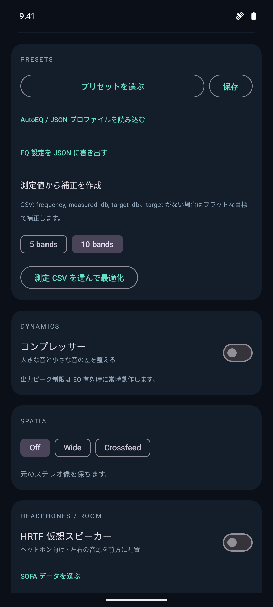
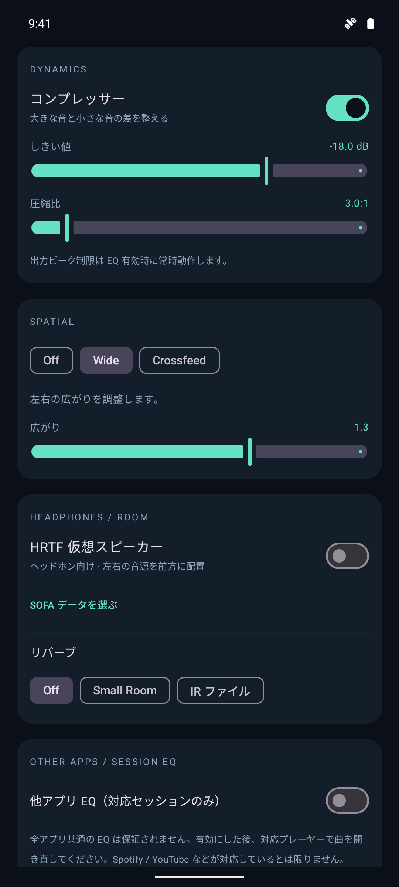
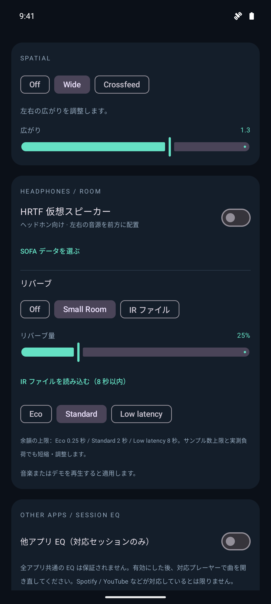
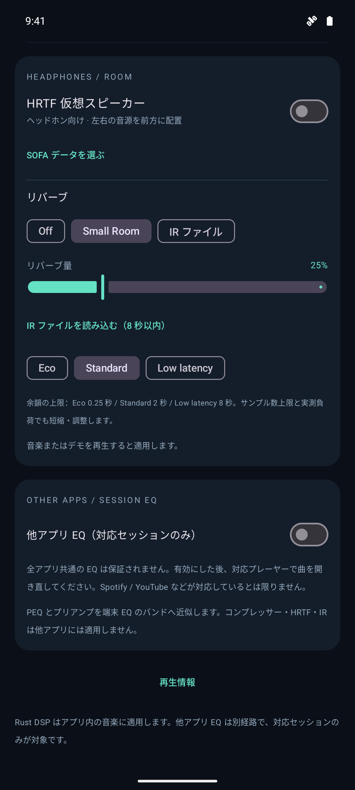

# Rust EQ 紹介用スクリーンショット

Androidエミュレーター上のPNG原本です。01〜06は **Rust EQ 0.3.0**、07〜08は **0.4.0** を撮影しています。すべて **1080 × 2400 px、縦向き**。画像をクリックすると原寸で開けます。

## 0.4.0の追加画面

| 標準プリセット | 疑似BASS |
|---|---|
|  |  |
| **07 — 音楽や用途に合わせて選ぶ** 16種類の標準プリセットと説明。 | **08 — 倍音による低音感を調整** 疑似ウーファーを選択した、量55%・抽出110 Hzの画面。 |

音声は停止した状態です。疑似BASSはアプリ内の再生音に適用されます。実際のウーファーの振動は再現しません。

## 0.3.0の画面

| 再生・EQ | バンド編集 |
|---|---|
|  |  |
| **01 — 自分の好みに音を整える** ローカル再生、31バンドPEQ、合成周波数応答グラフ。 | **02 — 細かく音を調整** 周波数・ゲイン・Q・プリアンプの調整。 |

| プリセット・AutoEQ | Dynamics・Stereo |
|---|---|
|  |  |
| **03 — 設定を保存、測定値から補正** プリセット、JSON入出力、CSVからの5/10バンド最適化の操作画面。 | **04 — 音量差と広がりを調整** コンプレッサーのしきい値・圧縮比とWideの設定。 |

| Spatial・Reverb | 他アプリEQ |
|---|---|
|  |  |
| **05 — 好みの空間表現を選ぶ** Wide・Small Roomを選択した適用待ちの画面。HRTFデータ選択、IR読み込み、品質切替。 | **06 — 対応プレーヤーと連携** 他アプリEQの設定と適用範囲の説明。 |

EQカーブは紹介用の設定例です。HRTFデータは未選択、他アプリEQは無効の状態で撮影しています。画面への文字の合成や画像加工はしていません。

撮影環境：API 35 / x86_64、表示密度360 dpi。ステータスバーはAndroidのデモモードを使用しています。撮影後にアプリ設定・表示密度・デモモードを元に戻しています。
